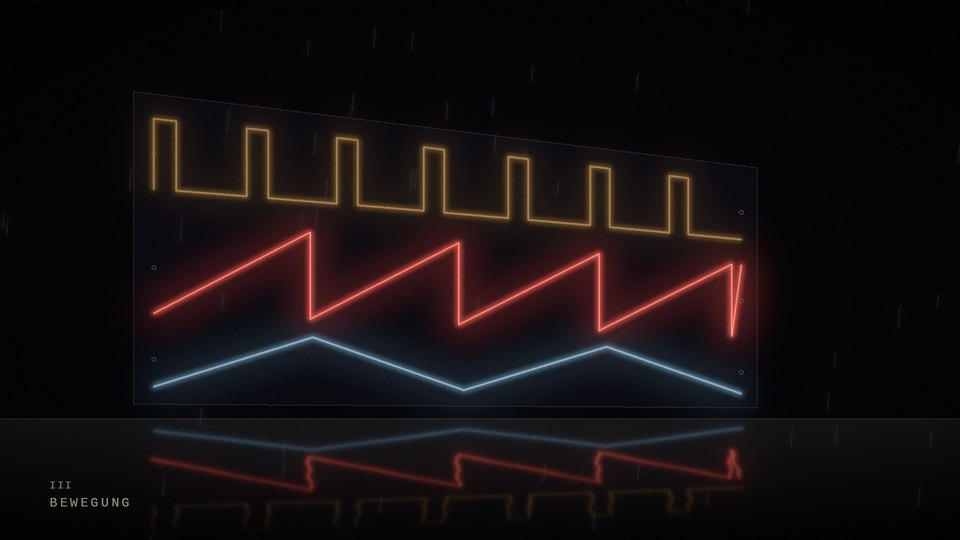
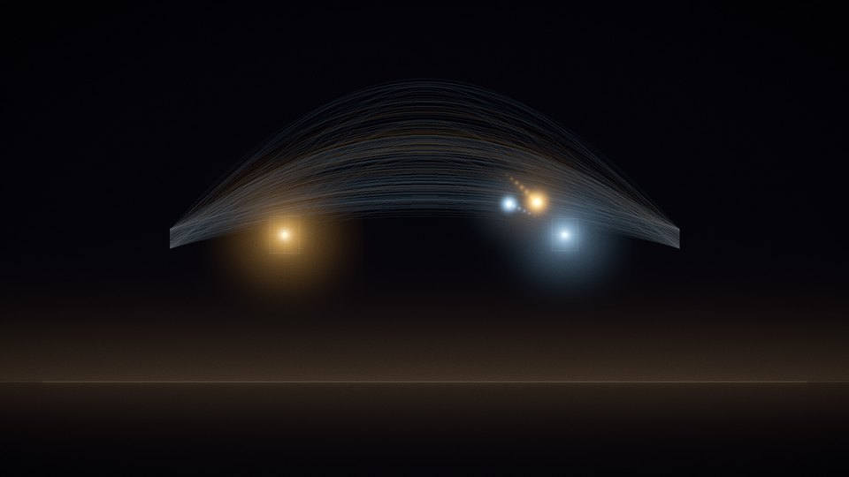
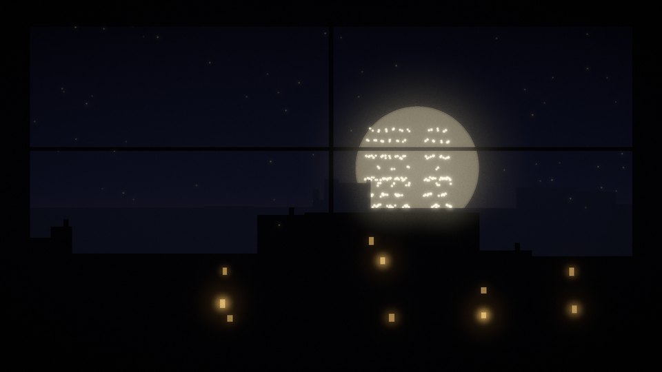
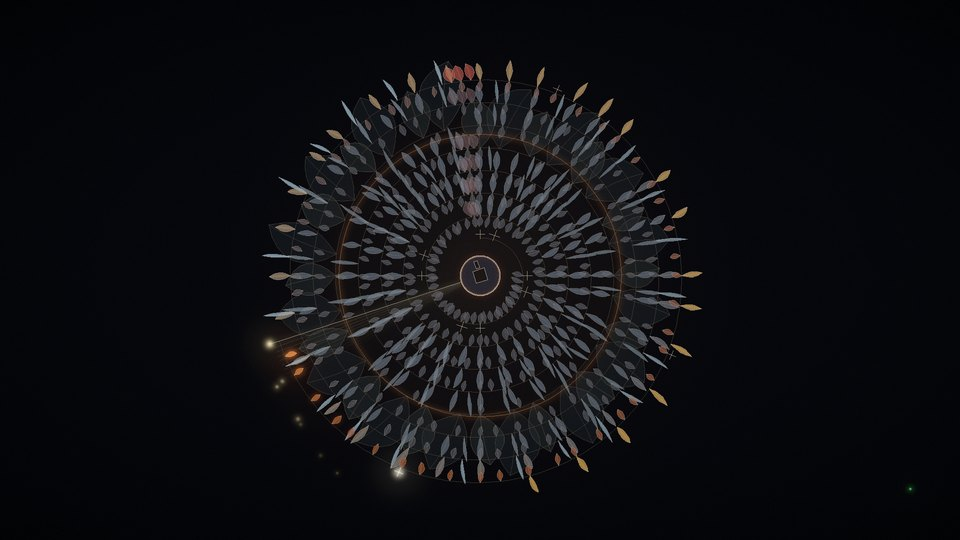
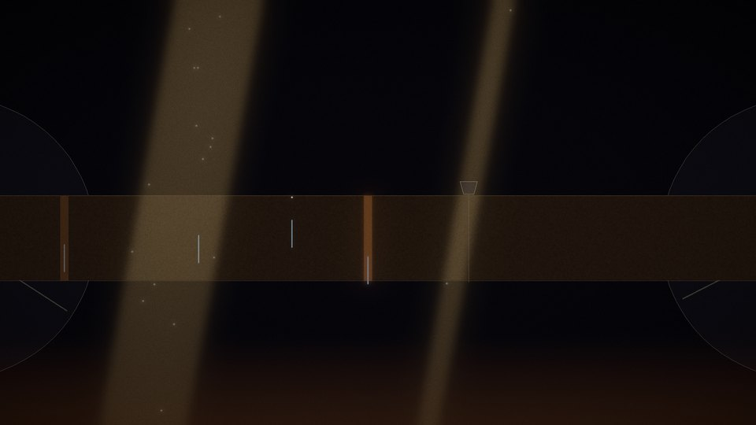
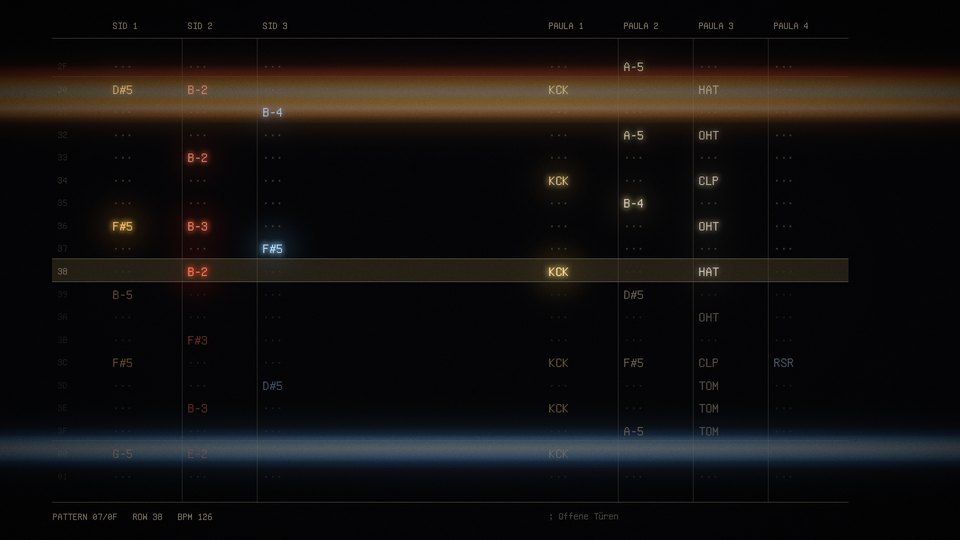
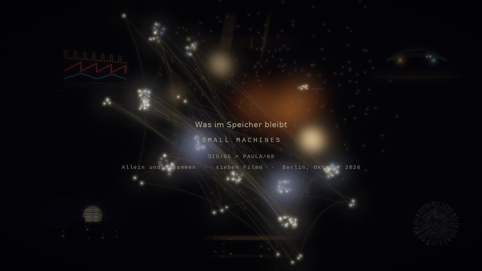
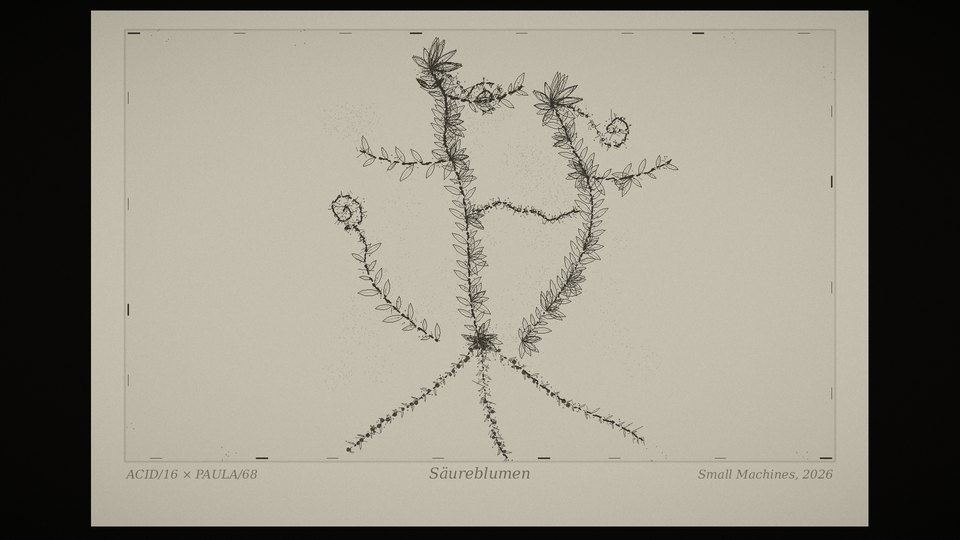

# Allein und zusammen — the films

Seven films for the seven pieces of **Allein und zusammen**, an eighth for the single **Säureblumen**, and a 32-second trailer. Each film is computed from the piece's score rather than from its audio: every note, sample, envelope and section becomes an image event on the sixteenth where it stands in the music, so the same score always yields the same film. SID is line and light; Paula is a thing — a petal, a hole in paper, a mark on tape.

| | Film | Lineup | Length |
| --- | --- | --- | --- |
|  | **Drei Stimmen im Neon** | SID/65 | 2:17 |
|  | **Ein Bit von dir** | SID/65 | 2:31 |
|  | **Papiermond** | PAULA/68 | 2:30 |
|  | **Diskettenblumen** | PAULA/68 | 2:03 |
|  | **Fensterlicht auf Magnetband** | SID/65 × PAULA/68 | 2:54 |
|  | **Zwischen zwei Takten** | SID/65 × PAULA/68 | 2:09 |
|  | **Was im Speicher bleibt** | SID/65 × PAULA/68 | 2:47 |
|  | **Säureblumen** | ACID/16 × PAULA/68 | 3:11 |

The rendered films (1920 × 1080, 30 fps, about 0.9 GB together) are not stored in Git. This folder holds what produces them:

- [`Liesmich.txt`](Liesmich.txt) — the images piece by piece, the trailer's cut list, credits and how to re-render (German).
- [`Videobeschreibungen.txt`](Videobeschreibungen.txt) — descriptions, credits and chapter marks for publishing each film.
- [`source/`](source/) — the Python renderer (numpy, OpenCV, Pillow, ffmpeg). `python3 render.py <film> <out.mp4>` reads the score from [`music/`](../../music/).

The scores in `music/early/seven-pieces/` and `music/saeureblumen/` are byte-identical to the ones the films were computed from. The same seven pieces appear on SM001–SM003 with identical events, mix levels, lengths and timing. Since 27 October 2026 the films carry these album recordings — chosen after a level-matched listening comparison with the EP — so the picture did not need to be re-rendered. The album masters can be rebuilt from `music/albums/SM001-003/` with the repository's `dist/`.

End cards name the piece, Small Machines and the instruments heard. Music and instruments: Frank with ChatGPT. Images: Frank with Claude. See [CREDITS.md](../../CREDITS.md).
